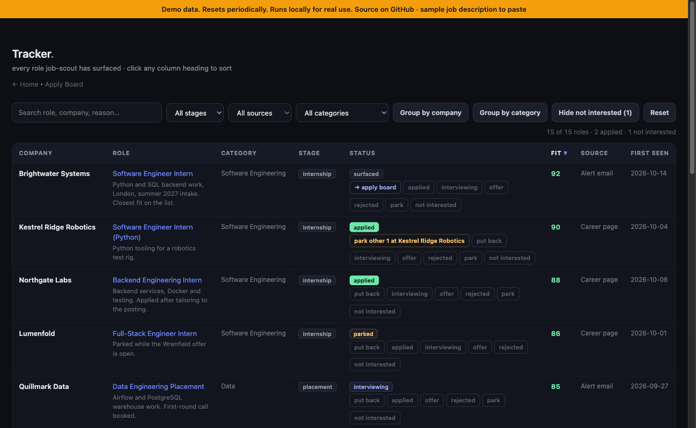
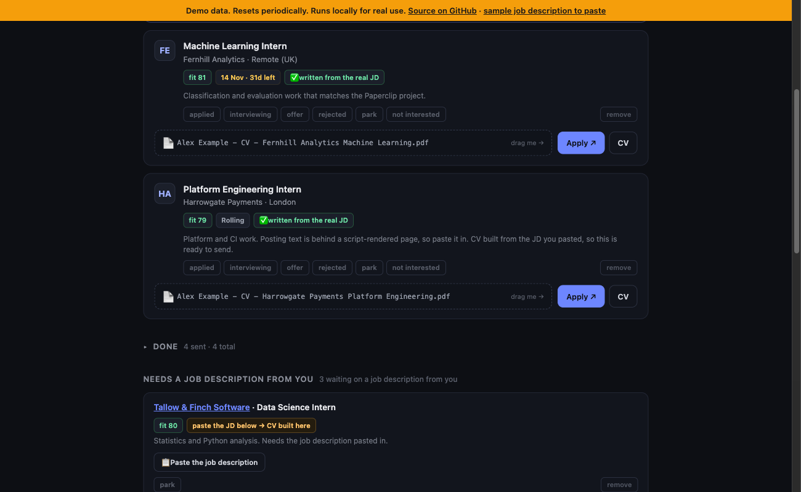

# job-scout

[](https://github.com/Ramy3077/job-scout/actions/workflows/ci.yml)

A job tracker that builds a CV tailored to each posting. **The offline builder (the
one in the live demo) never invents:** every line of a CV is checked verbatim against
your profile (`verify_against_profile`) before it is written, so a job description asking for Kubernetes cannot add
Kubernetes to a profile that lacks it. Same profile, two postings:

| | Machine learning internship | Platform engineering internship |
|---|---|---|
| Summary | "...working across machine learning and data analysis..." | "...building backend services and data pipelines..." |
| Projects | Paperclip Classifier, Tidepool | Tidepool, Pocket Budget |

Same sentences from the profile, different selection and order. Details in
[Why it can't fabricate](#why-it-cant-fabricate).

A local job tracker and tailored-CV builder. It reads job sources you choose,
scores roles against a preferences file you write, and gives you two boards on
`localhost`: a tracker of everything it has ever seen, and an apply board of
what is open now. Paste a job description into a card and it builds a CV
tailored to that posting.

Everything runs on your machine. Nothing is uploaded, and there is no account.

**Live demo: <https://job-scout-production-9842.up.railway.app>** (invented data,
resets periodically, see [Demo mode](#demo-mode)).




```bash
git clone https://github.com/Ramy3077/job-scout.git
cd job-scout
python3 serve.py
```

Then open <http://localhost:7777>. It works immediately with empty boards; the
setup below fills them.

## The two boards

**Tracker** is every role ever surfaced, sortable by any column and groupable
by company. Mark a role applied, parked or rejected, and park every other open
role at the same employer in one click, which matters at firms that treat one
application as covering several postings.

**Apply Board** is what is open now, split into open, opening soon, needs
checking, and closed. Each card takes a pasted job description and builds a CV
against it.

## Setup

Nothing here is required to start the server. Add each piece when you want the
feature it unlocks.

**1. Your profile.** The CV builder writes only from this file. It selects and
reorders what is there; it never invents.

```bash
cp config/profile.example.md data/profile.md
```

**2. Your preferences.** Decides what counts as a match.

```bash
cp config/prefs.example.md data/prefs.md
```

**3. Settings.** Optional. Copy `.env.example` to `.env` to move data out of
the repo, change the port, or set your CV filename prefix.

**4. A job source.** See [docs/sources.md](docs/sources.md).

LinkedIn, Gradcracker and Bright Network have no public API, so the route is
their **alert emails**: you let them mail you, filter those into a Gmail label,
and `fetch_mail.py` reads the label. It already recognises all three by sender.
The docs cover the alert setup, the Gmail filter and the app password.

You can also add a role by hand, for a referral or something you found
yourself:

```bash
python3 jobscout/state.py add --title "Software Engineer Intern" \
  --company "Example Corp" --url "https://jobs.example.com/swe-intern"
```

**5. LaTeX,** only if you want PDFs. The builder compiles with
[tectonic](https://tectonic-typesetting.github.io/) and renders the template with
Jinja2:

```bash
brew install tectonic
pip install -r requirements.txt
```

## How a CV gets built

1. You paste a job description into a card on the apply board.
2. `jd_build.py` reads that description and your profile.
3. It selects the bullets that fit, orders them for the role, and drops the rest.
4. `build_cv.py` renders `template.tex.j2` and compiles a PDF.
5. The file lands in your CV folder, named `<prefix><Company> <Track>.pdf`.

The filename matters more than it looks: a recruiter sees it in most ATS
uploads. No dates, no run metadata, and a rebuild overwrites rather than
minting a near-duplicate beside it.

The tailoring only ever reorders and selects. If a fact is not in your profile
it cannot reach a CV, which is the point: a CV that cannot be checked against
your own record is not worth sending.

## Why it can't fabricate

There are two builders, and they are not equally strong, so here is what each one
actually guarantees.

**Offline builder (`jobscout/select_cv.py`, used by demo mode).** No model is
involved. It parses your profile into facts, then:

- scores each bullet, project and skill by how many job-description terms it
  shares (stemmed, stopwords removed);
- keeps the top few bullets per role, the top two projects, picks the best of
  your own summary statements, and sorts skills by match;
- copies every string verbatim. Nothing is rewritten, so there is no step at
  which new text could enter.

It then checks its own output. `verify_against_profile` walks every string in the
CV (summary, titles, employers, dates, bullets, skills) and requires each to be
an exact member of the set of facts in your profile. `build_content` raises
instead of returning anything that fails. A job description asking for
Kubernetes cannot add Kubernetes to a profile that does not list it, and job
titles are never relabelled. The tests in `tests/test_select_cv.py` cover each of
these cases.

**Model builder (`jd_build.py`, local use).** Here a model writes the CV
content, constrained by the rules in `jobscout/prompt.md` (profile only, no new
titles, no invented numbers) and by treating the pasted job description as
untrusted data. That is a prompt, not a proof: the verifier above is not run on
this path, so read the CV before you send it. The offline builder exists partly
because it can promise more.

## Demo mode

`JOBSCOUT_DEMO=1` runs a sandbox for the hosted preview:

- on boot it seeds a temp directory with an invented profile (Alex Example) and
  15 roles at fictional companies, with varied statuses and dates;
- everything you do writes into that directory, and it is re-seeded every six
  hours (`JOBSCOUT_DEMO_RESET_HOURS`) and on every restart;
- `fetch_mail.py` and `fetch_trackr.py` refuse to run, and the server itself
  never calls out to anything;
- Build CV uses the offline builder and compiles a real PDF with tectonic;
- a banner on every page says it is demo data.

To try it, open a card under "Needs a job description from you" and click
"Paste sample JD", then Build CV. The result shows which profile lines were kept and
dropped, with match scores. To run it locally:

```bash
JOBSCOUT_DEMO=1 python3 serve.py
# or the container the live demo uses
docker build -t job-scout-demo . && docker run -p 7777:7777 job-scout-demo
```

The server binds `127.0.0.1:7777` by default. `JOBSCOUT_HOST` and
`JOBSCOUT_PORT` change that; the container sets the host to `0.0.0.0` and reads
`PORT`.

## Tests

```bash
pip install -r requirements.txt pytest
python -m pytest
```

They cover CV selection and the no-fabrication check, URL and company dedup,
board matching, filename rules, LaTeX escaping and the demo server. The PDF test
runs only if `tectonic` is installed. CI runs the same on every push.

## Layout

```
serve.py            the local server, stdlib only
Dockerfile          the hosted demo image
tests/              pytest suite
jobscout/
  select_cv.py      offline CV selection and the no-fabrication check
  demo.py           invented data for demo mode
  config.py         every path, resolved once, overridable by env
  state.py          SQLite schema, URL and company normalisation
  fetch_mail.py     source: Gmail over IMAP
  fetch_trackr.py   source: structured internship catalogue
  sync_applyboard.py  turns tracker rows into board cards
  jd_build.py       job description in, tailored CV out
  build_cv.py       JSON in, PDF out
  template.tex.j2   the CV layout
boards/             the two board UIs
config/             example profile and preferences
data/               your data. gitignored.
```

## Notes on safety

Job alert emails and job descriptions are **attacker-controlled text**. A
posting can contain instructions aimed at whatever reads it. This repo treats
every fetched document as data, never as instructions, and the CV builder runs
against an explicit allow-list of domains it may fetch. If you add a source,
keep that property.

Credentials never live in files. The Gmail source reads an app password from
the macOS Keychain.

## Licence

MIT. See [LICENSE](LICENSE).
